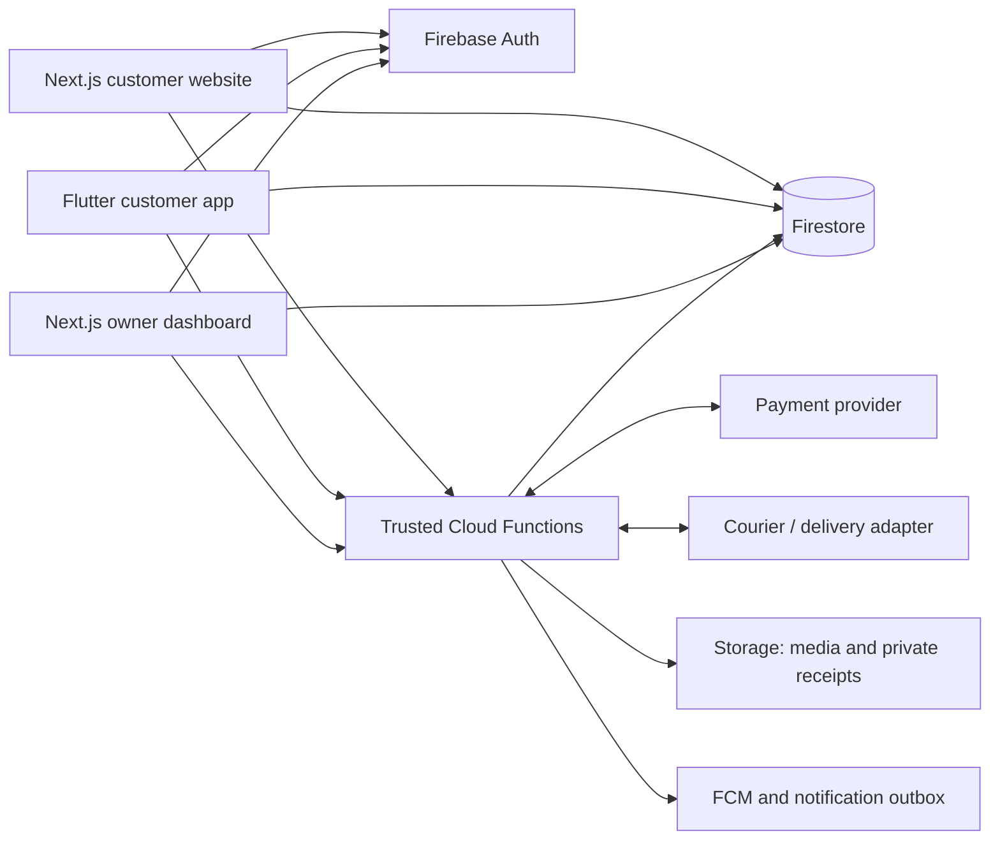

# Shared Firebase architecture

Status: implemented v1 plus future architecture, updated 20 October 2026. Next.js + Flutter + Firebase and local/nationwide launch coverage are user-confirmed. No hosted backend deployment has been performed.

## Implemented v1

The authoritative current API is [commerce contract v1](../contracts/v1/README.md).
It defines the four `asia-south1` callables: `quoteCheckout`, `placeCodOrder`,
`updateVariant` and `updateOrderStatus`. Both customer clients use Firebase
Auth, Firestore and those callables; owner mutations require the trusted
`admin:true` claim. Emulator mode uses the same isolated demo project.

V1 stores one product with `1l`, `2l`, `5l` variants, private `_inventory`,
exact PIN delivery rules, UID-scoped profile/default address/cart and
`web-v1`/`android-v1` guidance. Orders use ISO UTC creation strings,
integer paise, COD payment states and validated fulfillment transitions.
Stock is allocated when the order transaction commits; cancellation before
shipping restores it once. Quotes do not reserve inventory. Stable quote
and retry keys prevent ambiguous network failures from creating a new
purchase. No online payment, refund worker, courier booking, batch ledger
or push-notification service is implemented in this version.

The sections below retain the longer-term system proposal. Proposed paths,
functions and state machines are future design and must not be substituted
for the v1 contract when implementing current clients.

## System boundaries

Direct Firestore access is limited by rules to public catalogue/content and each customer's permitted personal records. Functions own commercial and privileged mutations. The payment gateway and courier are integrations used by the Firebase backend, not services that Firebase itself provides.

Use one Firebase project **per environment**. Register the Next.js web client and each Flutter native client against the same production project; keep development/emulator, staging, and production data separate. Align Firestore, Functions, and Storage locations where supported, considering Indian customer latency before resources are provisioned.

Recommended web deployment: Firebase App Hosting for Next.js server rendering, with the owner routes in the same web application. Hosting remains a proposal. A different Next.js host can use the same Firebase backend without changing the product model.

## What is interconnected

- The same customer UID owns orders, addresses, cart, preferences, and guide progress on both channels.
- Signing in with the same phone/provider identifies the same account; browser and app sessions are separate. Different authentication providers require explicit account linking rather than accidental duplicate accounts.
- Anonymous browsing/cart is device-local. On sign-in, merge the guest cart into the owned cart once using a defined quantity policy and a merge identifier; revalidate variants and quantities. Do not automatically repeat the merge on every reconnect.
- Active clients subscribe to permitted cart/order changes. Catalogue changes update client reads and invalidate web catalogue caches. Cached product content never substitutes for checkout validation.
- TypeScript and Dart share versioned JSON request/response contracts, status codes, identifiers, money units, and examples. They do not share executable UI code. The server is the authoritative implementation of price, tax, shipping, and stock rules.
- Use ordinary verified website links and platform App Links/Universal Links for product/order entry; do not introduce a separate deep-link database.

## Data model

| Path / collection | Purpose and ownership |
| --- | --- |
| `products/{productId}` | Published bilingual name, description, process, ingredients, storage and supplied label facts; media references and publication state. |
| `products/{productId}/variants/{variantId}` | Pack volume, current sale price/MRP and currency, packed weight/dimensions, enabled state, and safe stock-availability projection. Start with 1 / 2 / 5 L. |
| `inventory/{variantId}` | Private packed-stock aggregate: sellable on-hand, reserved, allocated, and computed available pack counts. Server-maintained. |
| `batches/{batchId}` and `inventoryMovements/{movementId}` | Private batch/packing facts and auditable receipts, reservations, releases, allocations, dispatches, returns, and adjustments. |
| `users/{uid}` | Customer display name and permitted preferences; verified phone comes from Auth. Privileged roles come from trusted custom claims, not editable profile fields. |
| `users/{uid}/addresses/{addressId}` | Owned delivery-address records with Unicode fields and normalized Indian phone/PIN data. |
| `users/{uid}/onboarding/{surfaceVersion}` | Guide progress, skipped/completed page IDs, and timestamps; for example `web-v1`, `android-v1`, `ios-v1`. Owner-readable/writable through validated fields. |
| `users/{uid}/devices/{deviceId}` | Owned notification token, platform, permission state, and last-seen time; remove stale tokens. |
| `carts/{uid}` | Owned variant IDs and quantities plus update/version metadata. Stored totals are never trusted for checkout. |
| `quotes/{quoteId}` | Server-created, UID-bound, time-limited commercial quote with cart/address fingerprint, rule versions, charge breakdown, eligibility, and estimated delivery range. |
| `checkoutSessions/{sessionId}` | Server-owned inventory reservation, quote snapshot, idempotency identity, payment method, attempt references, and outcome. Expose only the owner's safe status fields. |
| `orders/{orderId}` and `orders/{orderId}/events/{eventId}` | UID-owned order snapshot, source channel, items/prices/charges, address, payment state, fulfillment state, tracking, and append-only business events. Customers cannot edit authoritative order fields. |
| `paymentAttempts/{attemptId}`, `providerEvents/{eventId}`, `refunds/{refundId}` | Private gateway correlation, verified financial events, deduplication, and refund reconciliation. No gateway secrets in Firestore client-readable documents. |
| `deliveryRules/{ruleId}`, `publicContent/{documentId}`, `privateSettings/{id}` | Versioned delivery eligibility/rates; approved bilingual story/help/policies; private business/provider settings kept separate from public details. |
| `feedback/{feedbackId}` | Feedback tied to the customer's delivered order. A public review projection requires consent/moderation; initial absence is an empty state, not invented reviews. |
| `notificationOutbox/{id}` and `auditLogs/{id}` | Server-owned notification jobs and privileged change history. Order correctness does not depend on a successful push notification. |

Money is an integer in **paise** and currency is `INR`; pack volumes can be integer millilitres and packed weights integer grams. Example 1 L price: `45000` paise, still illustrative. Firestore timestamps are server-authored; API contracts serialize timestamps consistently as ISO-8601 UTC strings. Customer-facing times use the appropriate local format.

The order stores immutable purchase-time product/price/address/charge snapshots. Changing a product price or saved address never rewrites an old order. Do not infer package weight from oil litres alone.

## Authentication and permissions

- Customers: browse without authentication, then use phone OTP at checkout or Sign in. Web verification uses the appropriate Firebase web challenge; native clients use FlutterFire's platform verification setup.
- Owner/staff: provision authorized accounts and roles through trusted administration. Require the appropriate claim for every privileged function and rule; hiding `/admin` navigation is not authorization.
- Next.js server routes verify Firebase credentials/session cookies. Public server catalogue reads explicitly check publication status because the Admin SDK bypasses Firestore rules.
- Firestore rules deny all client writes to stock, quotes, checkout state, payment records, order totals/status, private settings, and audit logs. Validate allowed profile, address, cart, feedback, device, and onboarding fields.
- Owner-only customer data reads and order queries are scoped by UID. Rules are not filters: clients issue queries consistent with the permission constraints.
- Protect callable Functions with authentication, role checks where relevant, input validation, abuse limits, and production App Check. Payment/courier webhooks use their own signature verification rather than customer authentication.
- Keep merchant keys/webhook secrets in managed server secrets. Firebase public client configuration is not a merchant secret and does not replace rules or App Check.

## Checkout, payment, and stock consistency

1. **Quote.** `quoteCheckout` reads authoritative enabled variants, quantities, address/PIN eligibility, packed weight/rate rules, and payment-option eligibility. It returns the complete charge breakdown and expiry. A quote does not reserve stock.
2. **Reserve once.** `createCheckout` verifies the UID-bound quote, current rule/price validity, payment choice, and idempotency key. A Firestore transaction checks available packed units, reserves them, and writes a durable checkout session/attempt. Changed quotes require a visible refreshed review.
3. **Create the gateway order outside the transaction.** For online payment, create the provider order from the server amount/currency and persist the mapped provider ID before giving it to a client. External network calls are never placed in a retriable Firestore transaction callback. Correlate attempts durably, guard repeated calls, and reconcile ambiguous provider responses; an internal idempotency key is not a promise that a provider API is idempotent.
4. **Verify online payment on the server.** Validate the callback signature against the stored provider order; use a verified webhook and/or provider API fetch to confirm exact order, amount, currency, and captured state. Browser/app success text is not evidence of captured payment. Validate raw webhook bytes and persist event IDs to process duplicates safely.
5. **Finalize atomically.** A valid captured payment changes its reservation to allocated stock and creates/finalizes the order once. COD follows the same quote/stock controls and creates an order with `cod_due`; COD never appears paid merely because an order was submitted.
6. **Expire safely.** A scheduled worker atomically releases expired unpaid reservations. Do not rely on deleting a Firestore document through TTL to restore stock. Duplicate expiration jobs cannot release the same packs twice.
7. **Handle late payment.** If captured payment arrives after reservation expiry, atomically attempt allocation again. If stock or fulfillment is unavailable, record the captured funds and a review/refund exception, inform the customer, and run the approved refund process. Never silently confirm unavailable goods or lose the payment record.
8. **Dispatch and returns.** At dispatch, reduce sellable on-hand and allocated counts. A pre-dispatch approved cancellation releases allocation; goods already shipped are not automatically returned to saleable stock. Returned/damaged packs require an explicit physical stock decision.

For each variant, available packs are `sellableOnHand - reserved - allocated`; they must never become negative. Unsellable/expired/quarantined stock is excluded from sellable on-hand. All stock mutations and their ledger records occur together.

Gateway notifications can be duplicated, delayed, or out of order. Financial processing must be monotonic and reconciled. Notification jobs run after durable business transitions and can retry without creating new orders or repeating stock movements.

## Separate state machines

| Dimension | Proposed states |
| --- | --- |
| Checkout session | `reserved`, `payment_pending`, `finalized`, `failed`, `expired`, `review_required` |
| Payment | `awaiting_payment`, `processing`, `authorized`, `captured`, `failed`, `cod_due`, `collected`, `refund_pending`, `partially_refunded`, `refunded` |
| Fulfillment | `awaiting_confirmation`, `confirmed`, `packed`, `shipped`, `out_for_delivery`, `delivered`, `cancelled`, `return_requested`, `returned`, `review_required` |

Customer labels summarize these facts clearly. Refund success is confirmed from the provider, not from the initial refund request. Allowed fulfillment transitions are validated against the current state and role. Local delivery can move from Packed to Out for delivery without pretending a courier shipment exists.

## Shared function contracts

| Contract | Main responsibility |
| --- | --- |
| `quoteCheckout` | Authoritative totals, PIN/serviceability, delivery estimate, expiry, and available payment choices. |
| `createCheckout` | Quote verification, idempotent reservation/session creation, and online/COD branching. |
| `confirmOnlinePayment` | Validate provider callback data and return a reconciled backend outcome. |
| `requestCancellation` / `requestReturn` | Record a permitted owner-scoped request; no direct customer stock/refund mutation. |
| `prepareReorder` | Validate source-order ownership and return current variant/quantity choices and availability warnings for a new cart. |
| `adminSaveCatalogue` / `adminSaveContent` | Validate and publish business content, prices, and localization changes with audit records. |
| `adminAdjustInventory` | Validate a reasoned packed-stock movement and keep aggregate/ledger consistent. |
| `adminSaveDeliveryRules` | Validate versioned local/courier/rate/COD settings. |
| `adminUpdateOrder` / `adminInitiateRefund` | Enforce owner/staff permissions and valid fulfillment/financial transitions. |
| Verified HTTPS webhooks | Reconcile gateway/courier events, deduplicate, and update trusted records. |
| Scheduled/queued workers | Expire reservations, reconcile uncertain payments/refunds, and deliver notifications. |

Version the contracts and provide shared success/error fixtures for both TypeScript and Dart. Return machine codes such as `AUTH_REQUIRED`, `NOT_SERVICEABLE`, `QUOTE_EXPIRED`, `OUT_OF_STOCK`, `PAYMENT_PENDING`, and `PAYMENT_FAILED`; localize customer messages in each client. Include safe retry information without leaking provider internals.

## Local and nationwide delivery

- Use origin PIN/address, destination PIN, actual packed weight/dimensions, and declared oil packaging to determine serviceability, rates, and delivery estimates.
- Local rules define the supported area, order limits, fee, scheduling/estimate, and COD availability. Courier rules also consider provider serviceability and package/COD constraints.
- Select a courier/aggregator adapter after confirming that it accepts the actual edible-oil packages. A verified PIN allowlist and weight/rate table can support an initial operation; an unchecked India-wide wildcard cannot.
- Quotes show delivery and any COD charge before payment. A provider failure or missing rate returns an unavailable/retry state rather than free shipping.
- Initially, owner-entered tracking links/status are acceptable. Automated tracking can use signed provider events, with safe link validation and an owner correction trail.
- Delivery eligibility must be checked again at finalization when relevant; the business must supply real dispatch and transit ranges.

## Onboarding, support, and notification behavior

Persist guide progress separately for web/Android/iOS and by guide version. Only the signed-in user can change their permitted progress fields. Do not store identity documents or sensitive personal data in tour state. Preserve skipped/completed progress across devices of the same surface, and offer replay explicitly.

WhatsApp buttons open the owner's confirmed number with concise customer-controlled text, optionally an order reference. Opening WhatsApp does not place an order or verify payment. Automated WhatsApp notifications require a separate approved Business API integration and are outside the first release.

FCM supports opted-in app order notifications and owner alerts. Web push is optional and depends on browser permissions/support. Order history/tracking remains usable without push permission. Avoid full addresses or financial secrets in push payloads; receipt documents remain private to the order owner.

## Deployment and operating cost

App Hosting, deployed Cloud Functions, and current Cloud Storage use require planning for Firebase's Blaze billing setup. No-cost allowances are usage/location dependent and do not establish a zero operating bill. Phone OTP, payment processing, hosting/data transfer, courier, and app distribution costs are separate considerations.

Use budget alerts, reasonable instance/rate limits, image optimization, query pagination/indexes, and bounded listeners. Budget alerts do not impose a hard spending cap. Set up backups, logs without unnecessary PII, provider reconciliation, and a tested recovery path before accepting production orders.

## Official documentation consulted

Reviewed 12 October 2026 through Agent Reach's web reader. These sources validate platform/integration mechanics; they do not approve this business's merchant setup or provide a fixed cost quotation.

- [Firebase App Hosting](https://firebase.google.com/docs/app-hosting)
- [Firebase for Flutter setup](https://firebase.google.com/docs/flutter/setup)
- [Callable Cloud Functions](https://firebase.google.com/docs/functions/callable)
- [Functions deployment and billing](https://firebase.google.com/docs/functions/get-started)
- [Firestore transactions](https://firebase.google.com/docs/firestore/manage-data/transactions)
- [Firebase Security Rules basics](https://firebase.google.com/docs/rules/basics)
- [Auth account linking](https://firebase.google.com/docs/auth/web/account-linking)
- [Cloud Storage pricing-plan changes](https://firebase.google.com/docs/storage/faqs-storage-changes-announced-sept-2024)
- [Razorpay Flutter integration steps](https://razorpay.com/docs/build/llm-docs/payments/payment-gateway/flutter-integration/standard/integration-steps.md)
- [Razorpay web integration steps](https://razorpay.com/docs/payments/payment-gateway/web-integration/standard/integration-steps/)
