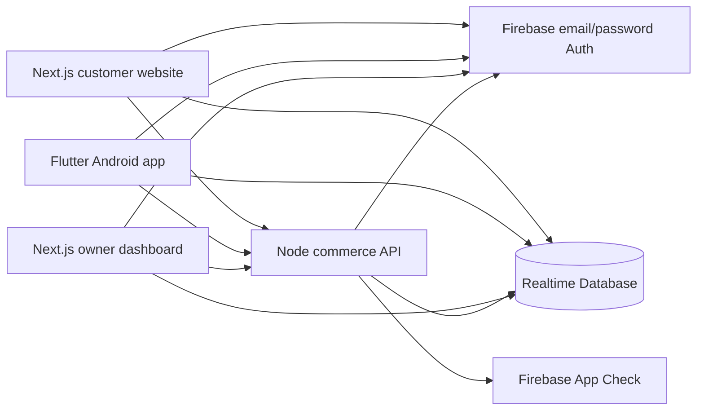

# Shared Realtime Database architecture

Updated 20 October 2026. User-confirmed stack: Next.js website,
Flutter Android app, Firebase Realtime Database, email/password Auth
and a separate Node API. The authoritative wire contract is
[commerce v1](../contracts/v1/README.md).

## System boundaries

Both customer clients read public catalogue/stock/content and their own
cart, default address, profile, guide progress and orders under database rules.
They send Firebase ID tokens to the Node API. Live API requests also require
App Check. The API alone changes prices, stock, quotes and authoritative orders.

TypeScript and Dart have separate interfaces and toolchains. They share
the JSON contract, identifiers, integer paise, statuses and server business
rules. A browser and phone have separate sessions but the same email account
maps to the same UID when connected to the same Firebase environment.

## Shared data

| Path | Purpose |
| --- | --- |
| `commerce/products/groundnut-oil` | Published bilingual product facts |
| `commerce/variants/{1l\|2l\|5l}` | Prices, litres, packed stock and enabled state |
| `commerce/publicContent/storefront` | Ordering/preview flags and optional support phone/notice |
| `commerce/deliveryRules/{pin}` | Exact PIN serviceability, COD, fee and estimate |
| `commerce/ordersByUser/{uid}/{orderId}` | Customer order history |
| `commerce/orderIndex/{orderId}` | Owner order view |
| `commerce/quotes/{quoteId}` | Private UID-bound expiring quote |
| `commerce/idempotency/{hash}` | Private durable completed operation receipt |
| `commerce/limits/{hash}` | Private per-account request limits |
| `users/{uid}/profile` | Display name, Auth email and language |
| `users/{uid}/addresses/default` | One default delivery address |
| `users/{uid}/onboarding/{web-v1\|android-v1}` | Optional surface-specific guide progress |
| `carts/{uid}` | Pack IDs/quantities and server update time |

RTDB and API timestamps are integer epoch milliseconds. The website
normalizes dates to ISO strings inside its UI; Flutter accepts the wire
milliseconds. Prices and totals use integer paise. Phone numbers are
delivery contacts; email/password establishes the account identity.

## Checkout and stock

1. A signed-in customer sends pack IDs, quantities, address and channel.
   The API checks the exact PIN and authoritative current terms.
2. The API returns a ten-minute quote with the complete COD total.
   A quote does not reserve stock.
3. The client saves a stable quote/retry key before requesting an order.
4. One transaction at `/commerce` checks the quote, stock and current terms,
   decrements packs and writes both order views plus the durable receipt.
5. A repeated completed operation returns the same order. Changed or expired
   unconsumed terms require a fresh visible review.
6. The client removes purchased cart quantities only when they still match
   the reviewed snapshot; newer edits survive.
7. Owner fulfillment progresses Received → Packed → Shipped → Delivered.
   Cancellation from Received or Packed restores stock once. Delivery marks
   COD collected. Customer cancellation/refund workflows are future work.

Both order views change atomically. Historical prices and addresses remain
purchase snapshots. No external merchant or courier integration participates
in the current transaction.

## Security and capacity

Default-deny RTDB rules scope personal data to its UID and deny direct client
writes to commercial records. Owner mutations require a trusted boolean
`admin:true` token claim; a profile field or hidden route cannot grant it.
The Node API verifies tokens, live App Check, inputs and all commercial terms.

The initial API uses a full commerce ledger transaction. This is a deliberate
small-store implementation: ledger reads/downloads grow as activity grows.
It currently bounds the ledger to 500 orders, 2,000 durable receipts,
750 quotes, 1,000 limit records and 4 MiB of JSON. Capacity errors preserve
orders and retry receipts and pause new operations. Completed receipts are
never silently evicted. Scaling requires an archival design that preserves
deduplication plus a more partitioned transaction strategy.

Expired unconsumed quotes are pruned after a grace period. Rate limits are
per UID and operation. Hosting-level abuse controls, operational backups,
PII retention/deletion and quota monitoring remain live operations work.
Avoiding Firebase billing does not guarantee unlimited free capacity.

## Environments and future integrations

Standalone demo data stays on the device. Connected local clients share
`demo-narayana-naturals` Auth/RTDB and a loopback Node API. Live clients share
`narayananaturals-6b5aa` and an explicitly hosted HTTPS API.

The live project has active RTDB and email/password Auth. Public hosting,
Admin credentials, production App Check/rules, confirmed store data and
release signing remain prerequisites for real sales. Online payments,
merchant webhook reconciliation, courier booking/tracking, notifications,
feedback and batch records can be added behind the same API later.
